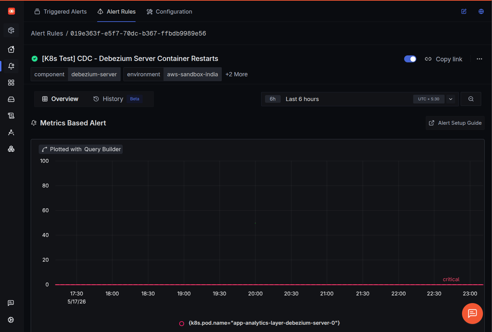

Every observability stack I've worked on eventually develops the same problem: alert drift. Someone clicks through the UI to silence a noisy rule "just for the weekend," forgets, and three months later nobody can reproduce why a particular query has `target: 0` instead of `target: 3`. The dashboard is in Git. The infrastructure is in Git. The deployment manifests are in Git. The alerts - somehow, always - are not.

I faced this problem with [SigNoz](https://signoz.io) after working with it twice for the past 1 year. SigNoz is a great open-source o11y platform, but the alert side of it lives entirely in the UI and the `/api/v2/rules` HTTP API. The community Terraform provider exists but is nascent, and Terraform brings its own choreography: versioning it in Git, ensure people don't run terraform from local and forget to push, also the Terraform provider for Signoz is incredibly buggy, I was fed up with '[Error: Provider produced inconsistent result after apply](https://github.com/SigNoz/terraform-provider-signoz/issues/75)'.

Meanwhile every other major observability platform I've used in the last two years has a Kubernetes-native alerting mechanism - Prometheus Operator's `PrometheusRule`, the Datadog Operator's `DatadogMonitor`, the Grafana Operator's `AlertRuleGroup`, Alertmanager's `AlertmanagerConfig`. Argo CD or Flux reconciling YAML out of Git, no separate pipeline, is *the* right shape for this problem.

So I built one for SigNoz: **[signoz-alert-operator](https://github.com/harsh098/signoz-alert-operator)**.

> ⚠️ Independent community operator. Not affiliated with, endorsed by, or sponsored by SigNoz Inc.

This post walks through what using it actually looks like - install to first alert in about five minutes.

---

## Install the operator

One `kubectl apply`. CRDs + controller + RBAC, into the `signoz-alert-operator-system` namespace:

```bash
kubectl apply -f https://github.com/harsh098/signoz-alert-operator/releases/latest/download/install.yaml
```

Verify the controller is up:

```bash
kubectl -n signoz-alert-operator-system get pods
# signoz-alert-operator-controller-manager-...   Running
```

The operator's tag mirrors the SigNoz version it was verified against - operator `v1.X.Y` ↔ SigNoz upstream `v0.X.0`. Latest is `v1.124.1` against SigNoz `v0.124.0`. Pin to a matching pair for predictable behaviour.

---

## Get an API key into the cluster (the right way)

The operator authenticates to SigNoz with an admin API key. You'll create one in **Settings → API Keys** in the SigNoz UI (`signoz-editor` scope), and the operator needs to read it from a Kubernetes `Secret`.

**Please don't `kubectl apply` a Secret out of your monorepo.** Use [External Secrets Operator (ESO)](https://external-secrets.io/) or the [Secrets Store CSI Driver](https://secrets-store-csi-driver.sigs.k8s.io/) to materialise it from your secret manager of choice. The Git artefact you commit should be a *reference*, not the secret itself. This matters here in particular because the SigNoz admin key can mutate every alert in the tenant.

With ESO, the manifest you commit looks like this (AWS Secrets Manager as the backend - works the same for Vault, GCP Secret Manager, Azure Key Vault, 1Password, Doppler, etc.):

```yaml
apiVersion: external-secrets.io/v1beta1
kind: ExternalSecret
metadata:
  name: signoz-api-key
  namespace: stage
spec:
  refreshInterval: 1h
  secretStoreRef:
    name: aws-secrets-manager
    kind: ClusterSecretStore
  target:
    name: signoz-api-key        # ← Secret name your Endpoint will reference
    creationPolicy: Owner
  data:
    - secretKey: api-key        # ← key inside the Secret
      remoteRef:
        key: stage/signoz/api-key
```

ESO reconciles a real Kubernetes Secret on a schedule, the operator reads it on each reconcile, your Git repo never sees plaintext credentials. The Secrets Store CSI Driver achieves the same end via a different mechanism - pick whichever your platform already standardises on.

---

## The two CRDs you'll use

Just two, and you'll mostly forget one of them exists after first setup:

- **`Endpoint`** - points at a SigNoz instance (URL + Secret reference). Create one per SigNoz tenant per namespace. No controller, no reconcile loop - it's a typed reference object so individual alerts don't repeat credentials.
- **`Alert`** - references an `Endpoint` and carries the SigNoz rule body as-is. The operator forwards `spec.rule` verbatim to `/api/v2/rules`, surfaces SigNoz's response on `status`, and uses a finalizer to clean up the upstream rule when you `kubectl delete`.

---

## A complete example

A real alert from my own stack: fire if a Debezium Server pod restarts in a 5-minute window, grouped by pod, scoped to the `aws-sandbox-india` environment. Apply these two manifests and you have a managed alert:

```yaml
apiVersion: monitoring.hmx86.cloud/v1alpha1
kind: Alert
metadata:
  name: dbz-container-restarts
  namespace: stage
spec:
  endpointRef:
    name: signoz
  rule:
    alert: "[K8s Test] CDC - Debezium Server Container Restarts"
    alertType: METRIC_BASED_ALERT
    ruleType: threshold_rule
    version: v5
    evalWindow: 5m
    frequency: 1m
    description: "Debezium Server container is restarting. Restarts cause offset re-reads, potential re-snapshots, and temporary CDC pipeline downtime."
    labels:
      component: debezium-server
      method: health
      environment: aws-sandbox-india
    condition:
      compositeQuery:
        queryType: builder
        panelType: graph
        queries:
          - type: builder_query
            spec:
              name: A
              signal: metrics
              stepInterval: 60
              aggregations:
                - metricName: k8s.container.restarts
                  timeAggregation: increase
                  spaceAggregation: sum
              filter:
                expression: "k8s.container.name = debezium-server"
              groupBy:
                - name: k8s.pod.name
                  fieldContext: resource
      selectedQueryName: A
      op: "1"
      target: 0
      matchType: "1"
    preferredChannels:
      - "Signoz AWS Alerts."

---
apiVersion: monitoring.hmx86.cloud/v1alpha1
kind: Endpoint
metadata:
  name: signoz
  namespace: stage
spec:
  instanceURL: https://YOUR_SIGNOZ_ENDPOINT.us2.signoz.cloud
  secretKeyRef:
    name: signoz-api-key
    key: api-key
```
The spec for `spec.rule` is same as the request schema for [/api/v2/rules](https://signoz.io/api-reference/v0.124.0#/operations/CreateRule). 

A handful of footguns worth knowing before you `kubectl apply`:

- **`version: v5` is required**, even though SigNoz's OpenAPI spec reads it as optional.
- **`op` and `matchType` use numeric string codes** (`"1"` = above / at_least_once), *not* the named enums in the docs. The UI's exported JSON uses the numerics; so does the API.
- **`preferredChannels` must reference channels that already exist** in SigNoz by name. Create the channel once in the UI (Settings → Channels) and reference it from YAML forever after.
- **Don't set `labels.k8s_id` yourself** - the controller injects it as `<namespace>-<name>`. It's how the operator finds the rule in SigNoz across cluster moves.

---

## Verify it worked

```bash
kubectl -n stage get alert dbz-container-restarts -o yaml
```

Look at `status`:

```yaml
status:
  ruleID: "019e363f-e5f7-70dc-b367-ffbdb9989e56"        # SigNoz-assigned id
  httpStatus: 201       # 201 on create, 200 on subsequent updates
  errors: ""            # SigNoz's error body if anything went wrong
```

`ruleID` populated and `httpStatus: 201` → the rule is live. Confirm in the SigNoz UI: **Alerts → All Alerts**, look for "[K8s Test] CDC - Debezium Server Container Restarts."

If `ruleID` is empty and `errors` is set, that's SigNoz rejecting your rule body. The error text is usually specific enough to point at the bad field - fix `spec.rule` and re-apply.



---

## The day-to-day workflow

This is the part you'll spend 99% of your time in:

**Update a rule.** Edit the `Alert` manifest, re-apply. The controller diffs, sends `PUT /api/v2/rules/{ruleID}` to SigNoz, bumps `status.httpStatus` to 200. Same rule id upstream, so alert history and notifications keep flowing.

```bash
kubectl apply -f alert.yaml
```

**Delete a rule.** A finalizer ensures the SigNoz-side rule is removed *before* the K8s object is garbage-collected. Typically completes in under two seconds.

```bash
kubectl -n stage delete alert dbz-container-restarts
```

If the rule was already deleted from the SigNoz UI, the controller tolerates the 404 and removes the finalizer anyway - `kubectl delete` won't hang.

**Migrate to a new cluster.** This is the trick that made me actually trust the operator in production. `kubectl apply -k` the same alert manifests into a new cluster pointing at the *same* SigNoz instance: the new cluster's `Alert` CR starts with empty `status.ruleID`, the controller lists rules in SigNoz on first reconcile, finds the one labelled `k8s_id: <namespace>-<name>`, and adopts its id rather than creating a duplicate. Same trick lets you sanely promote the same manifests across dev/staging/prod clusters when they share a backend.

**Manage many SigNoz tenants from one cluster.** Create one `Endpoint` per target; each `Alert` picks its target via `spec.endpointRef.name`. Convenient when a management cluster ships alerts to per-environment SigNoz tenants.

```yaml
apiVersion: monitoring.hmx86.cloud/v1alpha1
kind: Endpoint
metadata: { name: signoz-prod, namespace: monitoring }
spec:
  instanceURL: https://prod.signoz.cloud
  secretKeyRef: { name: signoz-prod-credentials, key: api-key }
---
apiVersion: monitoring.hmx86.cloud/v1alpha1
kind: Endpoint
metadata: { name: signoz-staging, namespace: monitoring }
spec:
  instanceURL: https://staging.signoz.cloud
  secretKeyRef: { name: signoz-staging-credentials, key: api-key }
```

---
## What's next

The thing I'm working on next - and the reason I think Kubernetes-native is the right home for SigNoz config more broadly - is a **`Dashboard` CRD**. Same model: build the dashboard once in the SigNoz UI, export the JSON, paste under `spec.dashboard:`, commit to Git, reconcile into SigNoz. The dashboards-in-the-UI / alerts-managed-by-the-operator split is unsatisfying. I'd like to close it.

If you're running SigNoz in anything resembling a serious production setup, give the operator a try. Repo is [here](https://github.com/harsh098/signoz-alert-operator), Apache-2.0, issues and PRs welcome. Full walkthrough - including bootstrapping a SigNoz API key against the `/api/v1/service_accounts` flow - lives in [Usage.md](https://github.com/harsh098/signoz-alert-operator/blob/main/Usage.md).

---
## Repo

  