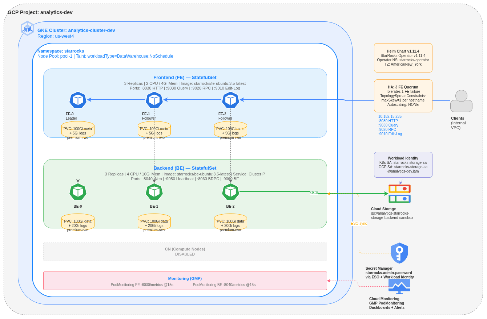
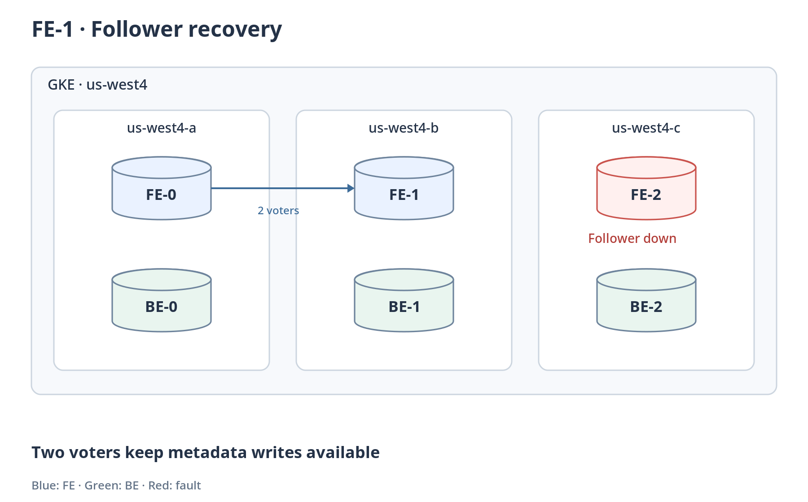
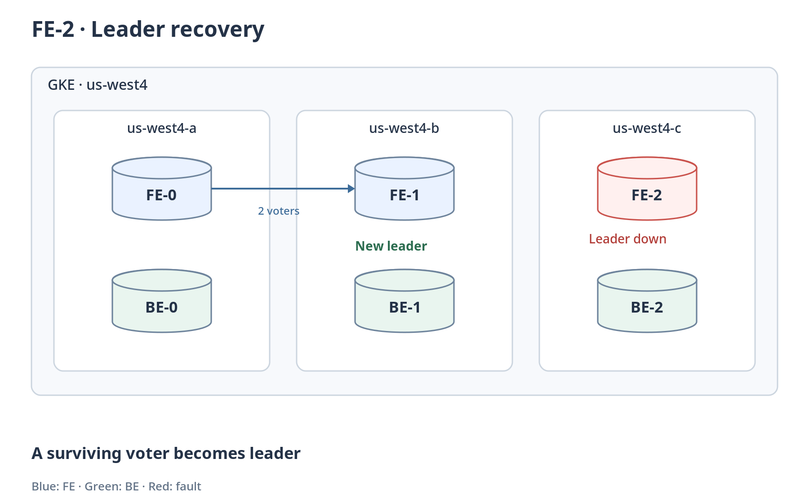
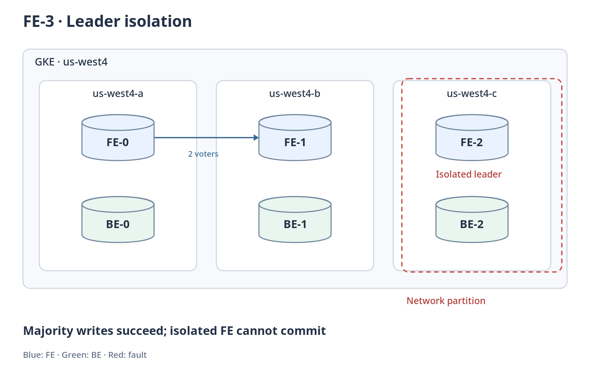
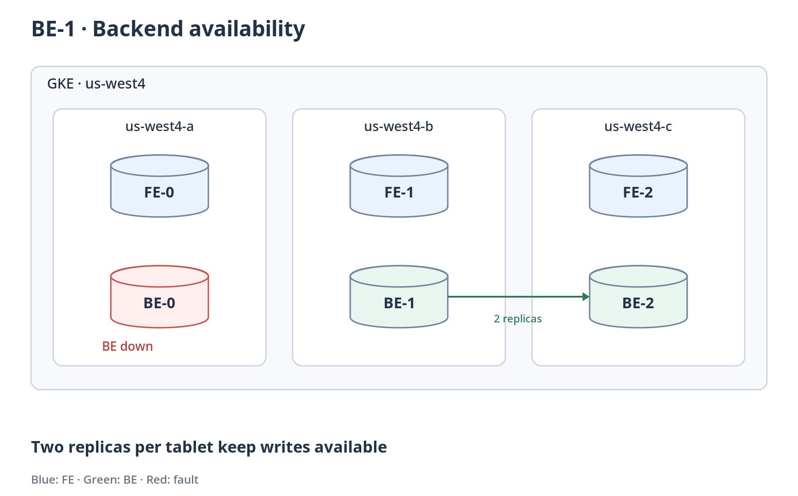
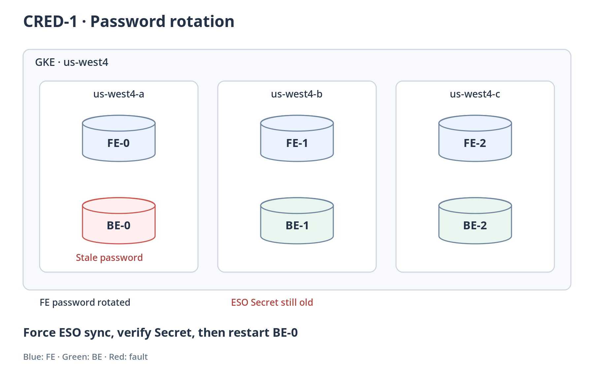

> This post accompanies the [Data on Kubernetes Community series](https://dok.community/blog/starrocks-kubernetes-fmea-part-1/).

In Part 1, we used failure modes and effects analysis (FMEA) to ask what could interrupt StarRocks on GKE. Here we set up the lab, test one fault at a time, and check how the cluster recovers. [Read Part 1](https://dok.community/blog/starrocks-kubernetes-fmea-part-1/).

This article is for SREs and Kubernetes engineers who test stateful workloads. We check what the client sees, whether a member rejoins, and whether the table gets all its replicas back.

## Set up the lab

We ran StarRocks 3.5.21 in shared-nothing mode on a regional GKE Standard cluster. We used StarRocks Operator 1.11.4. The cluster had three workers, one in each zone. Each worker ran one voting Frontend (FE) and one Backend (BE). Each FE and BE had its own zonal disk.

The worker pool had a fixed size. When we cordoned a worker, Kubernetes had no other worker in that zone for the replacement pod. This let us keep the member unavailable during a test.



*The StarRocks topology from Part 1. For these tests, we used six 25 GiB volumes.*

Use a separate GCP project with billing enabled. Check that it has enough quota for three workers with eight vCPUs each and 300 GiB of SSD capacity. Install OpenTofu, Helm, `kubectl`, the Google Cloud CLI, and the GKE authentication plugin. [Lab setup requirements](https://github.com/harsh098/starrocks-gke-fmea/blob/main/README.md#requirements).

Clone the repository. Sign in to Google Cloud and copy the example variables file.

```bash
git clone https://github.com/harsh098/starrocks-gke-fmea.git
cd starrocks-gke-fmea
gcloud auth login
gcloud auth application-default login
cp infra/terraform.tfvars.example infra/terraform.tfvars
```

In `infra/terraform.tfvars`, set `project_id` to your GCP project ID. Set `admin_cidr` to your public IPv4 address followed by `/32`.

Create the GKE cluster. Connect to it and install StarRocks with the smaller disk profile. Run the topology and smoke checks before you introduce a fault.

```bash
tofu -chdir=infra init
tofu -chdir=infra plan -out=lab.tfplan
tofu -chdir=infra apply lab.tfplan
./scripts/connect.sh
export KUBECONFIG="$PWD/.local/kubeconfig"
SR_VALUES_FILE=deploy/small-storage-values.yaml ./scripts/deploy.sh
./scripts/topology.sh
./scripts/smoke-test.sh
```

The smoke test creates `fmea.events` if the table does not exist. Before the first fault, we checked that all three FEs and all three BEs were alive. Each of the four tablets had three healthy replicas.

For the password test, we installed External Secrets Operator (ESO). We set its refresh interval to one hour before the first sync. [ESO setup and test procedures](https://github.com/harsh098/starrocks-gke-fmea/blob/main/experiments/README.md).

## Invariants in the system

Before each test, we define the conditions the cluster must satisfy during the fault and after recovery. We check these conditions through client responses, StarRocks membership, and tablet replica status.

1. **Crash-Recovery when an FE fails.**
   - After we remove the fault, the FE must restart and rejoin the cluster.
   - Its pod must become Ready and stop repeated restarts in `CrashLoopBackOff`.
   - `SHOW FRONTENDS` must report all three voting FEs as alive, with exactly one leader.
   - With one voting FE unavailable, the two connected voters must elect or retain a leader and commit valid metadata changes.
   - Metadata changes acknowledged during the fault must remain visible after recovery.

2. **Crash-Recovery when a BE fails.**
   - After we remove the fault, the BE must restart and rejoin the cluster.
   - Its pod must become Ready and stop repeated restarts in `CrashLoopBackOff`.
   - `SHOW BACKENDS` must report all three BEs as alive.
   - Each affected tablet must return to three healthy replicas on three distinct BEs.
   - `ADMIN SHOW REPLICA STATUS` must report `State = NORMAL`, `Status = OK`, and `IsBad = false` for every replica.
   - With one BE unavailable, valid writes must succeed when two healthy replicas of every affected tablet can acknowledge them.
   - Every acknowledged test row must remain readable after the BE recovers.

3. **Quorum safety, Split Brain, and Byzantine behaviour.**
   - A metadata change requires participation from at least two of our three voting FEs.
   - An isolated FE must never report a metadata change as committed without that voting majority.
   - A minority-side metadata probe must remain absent after recovery if the client received a rejection before any commit.
   - A timeout leaves the operation's outcome unknown. We must check the probe after recovery.
   - The cluster must prevent Split Brain. Both sides of a partition must never independently commit conflicting metadata changes.
   - With `write_quorum = MAJORITY`, each affected tablet requires acknowledgments from at least two of its three replicas.
   - If an affected tablet has fewer than two available replicas, the load must never report success.
   - A stale read from the minority FE is acceptable for this test. It does not demonstrate write availability or a metadata commit.
   - An FE that knowingly reports a metadata commit without a voting majority exhibits the Byzantine behaviour discussed in Part 1.

The partition injects link omission. We use it to check quorum safety and watch for the incorrect behaviour described above.

A violation of a required condition means the test fails. We record whether the failure affects safety, availability, or recovery.

- **Safety.** Does every acknowledged operation satisfy its quorum rule? Does the cluster prevent Split Brain?
- **Availability.** Do valid operations succeed while the required voters and tablet replicas remain available?
- **Recovery.** Do the affected members rejoin and restore all tablet replicas? Does recovery require operator intervention?

## Test Matrix

We use the invariants above to define each test. Before each fault, we verify three alive FEs, three alive BEs, and three healthy replicas per tablet. We restore this baseline before the next test.

| Test area | Test case # | Test | Assumed failure mode | PASS criteria | FAIL criteria |
| --- | --- | --- | --- | --- | --- |
| FE recovery | FE-1 | Cordon the follower's worker and force-delete the follower pod. Attempt a metadata change through a surviving FE. Uncordon the worker and check recovery. | FE process Crash-Recovery. | The two surviving voters commit the metadata probe. The replacement rejoins. All three FEs are alive with one leader, and the probe remains visible. | The connected majority cannot commit the probe, the follower cannot rejoin, or an acknowledged metadata change disappears. |
| FE recovery | FE-2 | Cordon the leader's worker and force-delete the leader pod. Attempt a metadata change through a surviving FE. Uncordon the worker and check recovery. | FE process Crash-Recovery and leader election. | The surviving voters elect one leader and commit the probe. The former leader rejoins, and the acknowledged probe remains visible. | The surviving voters cannot elect a leader or commit metadata, the former leader cannot rejoin, or the acknowledged probe disappears. |
| FE quorum safety | FE-3 | Isolate the leader's zone from the other database pods. Verify DNS and connectivity. Attempt distinct metadata changes on both sides and a data write on the majority side. Remove the partition and check recovery. | Network partition through link omission. Check for Split Brain and the Byzantine behaviour described in the invariants. | Majority-side metadata and data writes succeed. The minority reports no committed metadata change. Its rejected probe remains absent after recovery. All members and tablet replicas recover. | A minority FE confirms a metadata commit without two voters, both sides commit conflicting metadata, an acknowledged write disappears, or membership and replicas fail to recover. |
| BE availability and recovery | BE-1 | Cordon one worker and force-delete its BE pod. Confirm that StarRocks marks the BE down. Insert a unique row, then uncordon and check recovery. | BE process Crash-Recovery with one unavailable replica per affected tablet. | The insert succeeds with two healthy replicas per affected tablet. The row remains readable after recovery. All three BEs are alive, and every tablet has three healthy replicas on distinct BEs. | The insert fails despite two healthy replicas per affected tablet, the acknowledged row disappears, the BE cannot rejoin, or any replica remains unhealthy. |
| Credential rotation | CRED-1 | Start ESO with a one-hour refresh interval. Rotate the database and provider passwords. Confirm the target Secret is stale, then restart one BE. Record the failure before applying the fix. | Credential synchronization delay exposed by BE Crash-Recovery. | The replacement BE authenticates and returns to service without a forced sync or another restart. All affected tablets regain three healthy replicas. | The replacement BE reads the old password and cannot authenticate or return to service. This is the expected failure of the rotation workflow. |
| Planned maintenance | SURGE-1 | Run continuous write probes during an actual GKE surge upgrade. Compare worker, pod, and volume identities, then check acknowledged rows and tablet health. | Planned worker replacement and FE/BE Crash-Recovery. | All acknowledged inserts remain readable. All three FEs and BEs recover, each tablet regains three healthy replicas, and the six database volume bindings remain intact. | An acknowledged insert disappears, a member cannot rejoin, a database volume binding is lost, or tablet redundancy fails to recover. |

For CRED-1, recovery follows the failed test. We force ESO to sync, verify the target Secret, and replace the affected BE container. We then check registration, acknowledged rows, and three healthy replicas per affected tablet. Successful recovery completes the remediation. The original test verdict remains **FAIL**.

The forced pod exits exercise database process Crash-Recovery. The surge test uses the separately recorded GKE worker upgrade. For any client timeout, we check the operation after recovery before we assign its outcome.


## FE-1 : Follower recovery

We remove one FE follower and check that the two remaining voters can commit a metadata change. We then let the follower return and verify its membership and stored metadata.



*Schematic placement. The runner selects the actual members and zones.*

### Procedure

1. Check FE membership and select a follower automatically.
2. Cordon its worker and force-delete the selected pod.
3. Wait for StarRocks to mark the follower down.
4. Create a unique database through a surviving FE.
5. Uncordon the worker. Verify rejoin, the same PVC claims, and the probe database.

### Observations

Run the test from the repository directory.

```shell
python3 scripts/run-member-test.py FE-1
```

```text
Baseline: 3 alive FEs, 3 alive BEs, 12 healthy tablet replicas.
Outage: starrocks-fmea-fe-2 Alive=false.
Client probe: acknowledged.
Readback: acknowledged probe is present.
Leader: starrocks-fmea-fe-0
Recovery: 3 alive FEs, 3 alive BEs, 12 healthy replicas.
Storage: same PVC claims; replacement pod has a new UID.
Status: PASS
```

### Status

**PASS.** The client probe succeeded during the outage, and the database recovered.


## FE-2 : Leader recovery

We remove the FE leader and check whether the two remaining voters elect a replacement. We then commit a metadata change and verify the former leader rejoins.



*Schematic placement. The runner selects the actual members and zones.*

### Procedure

1. Discover the current leader and a surviving FE.
2. Cordon the leader’s worker and force-delete its pod.
3. Wait for the old leader to become unavailable.
4. Create a unique database through a surviving FE.
5. Uncordon the worker. Check leadership, membership, PVC claims, and the acknowledged metadata.

### Observations

Run the test from the repository directory.

```shell
python3 scripts/run-member-test.py FE-2
```

```text
Baseline: 3 alive FEs, 3 alive BEs, 12 healthy tablet replicas.
Outage: starrocks-fmea-fe-2 Alive=false.
Client probe: acknowledged.
Readback: acknowledged probe is present.
Leader: starrocks-fmea-fe-1
Recovery: 3 alive FEs, 3 alive BEs, 12 healthy replicas.
Storage: same PVC claims; replacement pod has a new UID.
Status: PASS
```

### Tip

BDB JE stores replication state in the FE metadata directory, configured through `meta_dir` and often mounted as `fe_meta`. A stale FE must catch up with the leader. An invalid BDB JE environment or damaged metadata can prevent the FE from starting or rejoining. Preserve the metadata directory before attempting recovery. [StarRocks metadata recovery](https://docs.starrocks.io/docs/administration/Meta_recovery/).

For planned GKE maintenance, we prefer blue-green upgrades over the default surge strategy. Blue-green creates replacement capacity before draining the old pool and provides batch and pool soak periods. Use that time to check FE membership, metadata writes, and tablet recovery before continuing. Our lab exercised surge upgrades. The blue-green preference follows its maintenance controls. [GKE upgrade strategies](https://docs.cloud.google.com/kubernetes-engine/docs/concepts/node-pool-upgrade-strategies).

### Status

**PASS.** The client probe succeeded during the outage, and the database recovered.

### Identified Risks

A leader re-election and failover can briefly drop TCP connections which may interrupt client requests. Given Starrocks does not support Transactional DDL, keep backups handy to avoid broken schema state in case an outage occurs during a Schema change. This is rare, but a perfectly possible failure mode when running a DB on Kubernetes.

## FE-3 : Leader isolation

We isolate the leader’s zone from the other database pods. We test metadata writes from both sides, then restore communication and inspect the committed state.



*Schematic placement. The runner selects the actual members and zones.*

### Procedure

1. Find the leader and its zone.
2. Apply the partition. Verify DNS, blocked cross-zone links, and communication between the majority FEs.
3. Attempt distinct database creates on the majority and minority sides.
4. Insert a unique row from the majority side.
5. Remove the partition. Check both database names, the row, all members, and tablet replicas.

### Observations

Run the test from the repository directory.

```shell
bash scripts/run-partition-test.sh
```

```text
FE-3: starting baseline and connectivity checks.
Partition: DNS verified; cross-zone connections blocked; majority FEs connected.
Majority metadata probe exit: 0
Minority metadata probe exit: 1
Majority insert exit: 0
Readback: majority database and row present; minority database absent.
Recovery: 3 alive FEs, 3 alive BEs, 12 healthy replicas.
Status: PASS
```

### Status

**PASS.** The client probe succeeded during the outage, and the database recovered.

### Identified Risks

The policy simulates a database network partition. DNS and Kubernetes control-plane access remain available.

## BE-1 : Backend availability

We keep one BE unavailable while writing to an existing table. After the BE returns, we check the acknowledged row and every affected tablet replica.



*Schematic placement. The runner selects the actual members and zones.*

### Procedure

1. Check baseline membership and tablet health.
2. Cordon the worker and force-delete one BE pod.
3. Wait for StarRocks to mark the BE down. Capture tablet status.
4. Insert a unique row while two BEs remain available.
5. Uncordon the worker. Check BE registration, the row, and three healthy replicas per tablet.

### Observations

Run the test from the repository directory.

```shell
python3 scripts/run-member-test.py BE-1
```

```text
Baseline: 3 alive FEs, 3 alive BEs, 12 healthy tablet replicas.
Outage: starrocks-fmea-be-0 Alive=false.
Client probe: acknowledged.
Readback: acknowledged probe is present.
Recovery: 3 alive FEs, 3 alive BEs, 12 healthy replicas.
Storage: same PVC claims; replacement pod has a new UID.
Status: PASS
```

The tablet checks recorded the following states.

| Check | Healthy replicas | DEAD replicas |
| --- | --- | --- |
| While BE-0 was down | 8 | 4 |
| After recovery | 12 | 0 |

### Status

**PASS.** The client probe succeeded during the outage, and the database recovered.

### Identified Risks

The cluster has only two available replicas per affected tablet during this outage. Another unavailable replica can prevent majority writes. In a cluster of N nodes, we can find the max failures using  the relation N ≥ 2f + 1, which means, for a cluster of 3 nodes, atleast 2 nodes need to be available. 

## CRED-1 : Password rotation

We rotate the root password while ESO polls hourly, then restart one BE before the target Secret updates. We record the failed restart and test recovery after a forced sync.

The BE explicitly needs the current root password in its `MYSQL_PWD` environment variable to authenticate to the FE and join the cluster. The startup scripts also use this credential for administrative SQL operations during cluster management. Rotating the database password requires updating the Secret and replacing the affected container so it receives the new environment value. [StarRocks Operator password rotation guide](https://github.com/StarRocks/starrocks-kubernetes-operator/blob/v1.11.4/doc/change_root_password_howto.md).



*Schematic placement. The runner selects the actual members and zones.*

### Procedure

1. Start ESO with hourly polling and verify the initial password sync.
2. Rotate the database password and update the provider source.
3. Confirm the target Secret still has the original password.
4. Restart one BE. Capture the authentication error and wait for StarRocks to mark it down.
5. Insert a unique row through the remaining BEs.
6. Apply the recovery procedure below and verify all replicas.

### Observations

Run the test from the repository directory.

```shell
bash scripts/run-credential-test.sh
```

The replacement BE read the stale password and failed to authenticate.

```text
ERROR 1045 (28000): Access denied for user 'root' (using password: YES)
Membership: selected BE Alive=false.
Write with two BEs: acknowledged.
```

### Status

**FAIL.** The BE required operator intervention to return after password rotation.

### Identified Risks

A shorter polling interval still leaves a stale Secret window. An ESO outage can extend it. Several failed BE restarts can remove write quorum.

### Fix

Force ESO to sync after updating the provider. Verify the target Secret, then replace the affected BE container.

The runner requests synchronization with this command.

```shell
kubectl -n starrocks annotate externalsecret starrocks-admin-password force-sync="$(date +%s)" --overwrite
```

It waits until the target Secret matches the new password, then replaces the affected BE.

```shell
kubectl -n starrocks delete pod starrocks-fmea-be-0 --wait=false
```

The runner checks the acknowledged row and all tablet replicas before restoring the original credential.

```text
Fix: forced ESO sync; target Secret matches the rotated password.
Recovery: BE registered, acknowledged row present, all 12 replicas OK.
Status: FAIL — stale credentials prevented BE restart.
Fix: verified; original credential and baseline restored.
```

## Conclusion

These tests let us examine Safety, Availability, and Recovery separately. The cluster continued through a single-member outage and recovered its replicas. Password rotation exposed a gap in how we coordinated the database credential, ESO, and container restarts.

### Safety

The connected FE majority committed metadata changes during the partition. The isolated FE refused the SQL connection, and its probe database was absent after recovery. We observed no Split Brain in this run.

The acknowledged inserts remained readable after recovery. In the separate surge run, all 279 acknowledged inserts survived worker replacement. These observations support the tested quorum and write-retention expectations.

### Availability

The cluster accepted metadata writes with one voting FE unavailable. When the leader disappeared, the remaining voters elected a replacement. Existing-table writes also succeeded with one BE down and two replicas available per affected tablet.

Availability depended on the operation. During the surge run, two direct SQL requests failed around leader handoff. Creating a three-replica table also failed while only two BEs were available, although existing-table majority writes could succeed.

### Recovery

Successful recovery required more than a Ready pod. We checked FE and BE membership, read back acknowledged writes, and verified three healthy replicas for each affected tablet.

CRED-1 failed because the replacement BE read a stale password and could not authenticate. We forced ESO to sync, verified the target Secret, and replaced the affected BE. Registration and all twelve tablet replicas recovered. This coordination must be part of the password-rotation procedure.

## Final Verdict

1. **Ready for production for our analytical workload.** Our verdict combines these lab findings with seven months of production experience. It depends on the deployment's quorum, placement, credential management, and recovery procedures.

2. **Upgrades need a scale-up and scale-down plan.** Make replacement capacity available in the disk's zone before removing a worker. Replace members in controlled steps. Check membership and tablet health before proceeding.

3. **Reserve a two-to-three-minute maintenance window for GKE upgrades.** This is our operating allowance for the workload. In our seven months of production experience, the cluster became available again in approximately two to three seconds after the interruptions we encountered. That brief interruption was acceptable for us. FE metadata recovery can take longer if BDB JE state is invalid or metadata is damaged, so we prefer blue-green upgrades for planned maintenance.

4. **Use batch ingestion and a replayable source.** For analytical workloads, prefer batch writes through Stream Load. Its asynchronous Merge Commit mode can accept data before the merged transaction finishes, so verify the final transaction status. For continuous ingestion, Kafka with Routine Load provides an asynchronous path. Keep source data long enough to replay batches during recovery, and design retries to avoid duplicate rows. [Stream Load](https://docs.starrocks.io/docs/loading/StreamLoad/), [Kafka Routine Load](https://docs.starrocks.io/docs/loading/kafka/RoutineLoad/).
